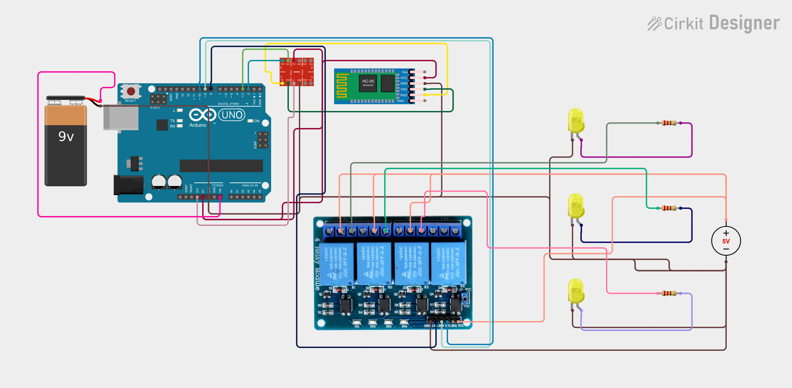

# Hardware — Smart Home Automation

This folder contains the circuit design and hardware documentation for the Smart Home Automation project created using Cirkit Designer.

## Circuit Diagram

The exported circuit image will be added here.

## Online Circuit Design

The interactive Cirkit Designer link will be added here.

[View or download the circuit diagram](circuit-diagram.png)

[Open the interactive circuit in Cirkit Designer](https://app.cirkitdesigner.com/project/693d52f0-2915-435c-b056-a12d7c2455ac)
